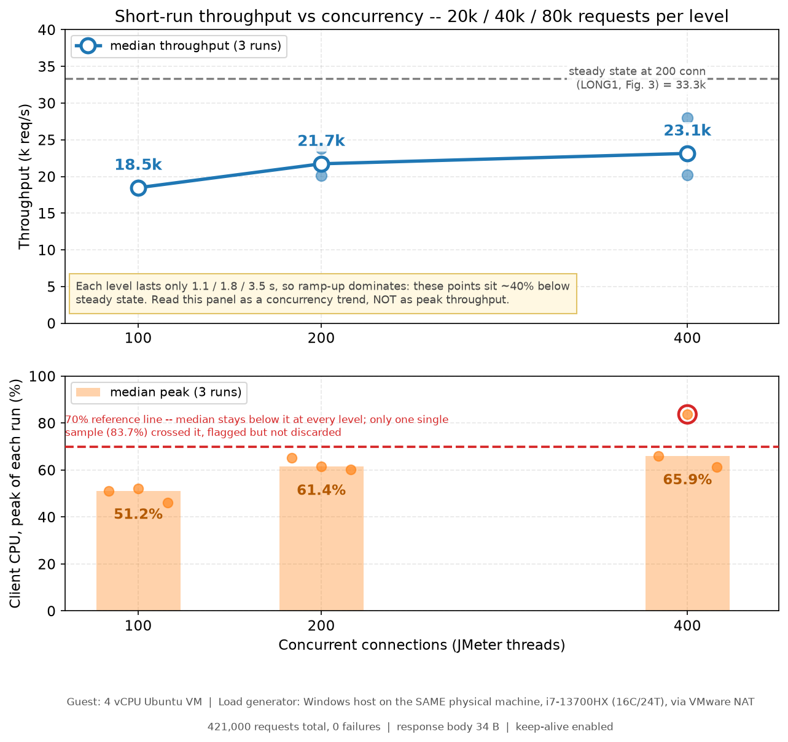
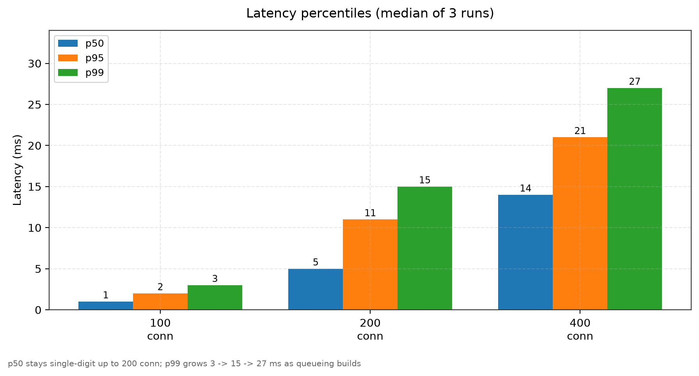
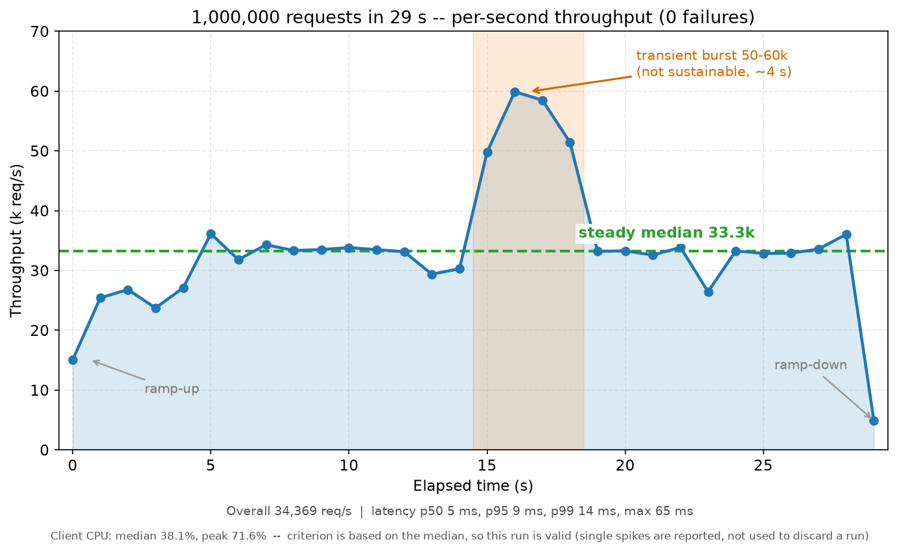
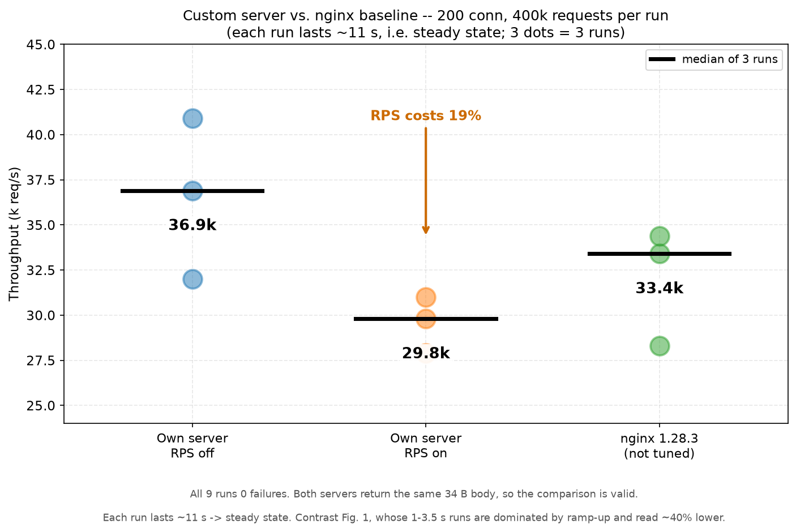

# p2 —— 从零手写的 Linux TCP / HTTP 服务器

一个学习用的极简 HTTP 服务器


## 当前状态

CP1 socket/bind/listen ✅ → CP2 accept ✅ → CP3 read ✅ → CP4 send ✅
→ CP5 半包/粘包 ✅ → CP6a~d epoll / EMFILE / keep-alive ✅ → 线程池 ✅

`src/` 下是三个可执行目标：

| 文件 | 并发模型 | 真实代码行 |
| --- | --- | --- |
| `src/p2.cpp` | 阻塞串行（一次一条连接） | 172 |
| `src/epoll.cpp` | 单线程 Reactor | 206 |
| `src/thread.cpp` | 单 Reactor + 线程池 | 370 |

## 编译与运行

```bash
mkdir -p build        # 产物统一输出到 build/（已 gitignore；清理就是 rm -rf build）

# 三个手写版（严格编译：有警告就说明代码不干净）
g++ -std=c++17 -Wall -Wextra -Wformat=2 -Wconversion src/p2.cpp         -o build/p2
g++ -std=c++17 -Wall -Wextra -Wformat=2 -Wconversion src/epoll.cpp      -o build/epoll
g++ -std=c++17 -Wall -Wextra -Wformat=2 -Wconversion src/thread.cpp     -o build/thread -pthread

# 起一个（⚠ 都占 8888，同时只能跑一个）
./build/epoll                                  # 或 ./build/p2
./build/thread --workers 4                     # 线程池版
```

端口：默认 8888，写在各自源码顶部的 `constexpr uint16_t PORT`；`thread` 支持 `--port N`。

另一个终端里访问：

```bash
curl -v http://127.0.0.1:8888/          # 看完整的请求/响应往返
curl -s -o /dev/null -w "%{http_code}\n" http://127.0.0.1:8888/   # 只打印状态码 → 200
# 或者直接用浏览器打开 http://127.0.0.1:8888/
```

## 测试

### 冒烟 + 健壮性测试（无需额外依赖）

```bash
# 终端1：启动服务器
build/p2

# 终端2：
python3 tests/p2_test.py                 # 默认 127.0.0.1:8888
python3 tests/p2_test.py --port 9999

# 边界行为（自己起服务器：分片发送 / 半关闭 / 慢连接隔离 / 流水线部分写）
python3 tests/edge_test.py --bin build/epoll
python3 tests/edge_test.py --bin build/thread
```

覆盖 5 个用例：

| # | 用例 | 断言 |
| --- | --- | --- |
| 1 | 正常请求 | 200 + 响应体正确 + `Content-Length` 与实际字节数一致 |
| 2 | **连上就关**（端口扫描 / 健康检查） | 服务器必须活下来并继续服务 |
| 3 | **RST 强断**（发一半请求后 `SO_LINGER=0`） | 服务器必须活下来并继续服务 |
| 4 | 并发 20 | 全部返回 200 |
| 5 | 半包观察（分两段发送） | 只记录现象，不计入失败（CP5 才修） |

用例 2/3 是回归测试：**单个坏客户端不该杀死服务器**（对应"响应只在 `n > 0` 时发送" + 忽略 `SIGPIPE`）。

### 压力测试（JMeter）

```bash
./tests/load_test.sh                                  # 默认阶梯 1 / 10 / 50 / 100 并发
./tests/load_test.sh 200 500                          # 200 并发 × 500 次
LEVELS="1:500 20:300 100:200" ./tests/load_test.sh    # 自定义阶梯
PORT=9999 ./tests/load_test.sh                        # 换端口
```

`load_test.sh` 会严格编译（有警告就停）、启动服务器、逐档跑 JMeter，再调用 `analyze.sh` 出分析表，结果落在 `tests/results/`。

#### 实测数据（2026-11-04 重跑，当前 HEAD）

同机压测：4 vCPU i7-13700HX / 15 GiB / `127.0.0.1`，JMeter 5.6.3 与服务器抢 CPU。
原始 `.jtl` 在 `tests/results/`（不入库）。只列关键档（未注明即 0 失败）：

| 场景 | 并发 | 吞吐 req/s | 说明 |
| --- | --- | --- | --- |
| p2（close，backlog 3） | 100 | 3,327 | 26/20,000 失败（ConnectTimeout） |
| epoll（close） | 100 | 8,234 | 0 失败；p2 → epoll 2.5× |
| epoll（keep-alive） | 100 | 12,399~12,995 | 比 close +51%~58% |
| epoll（keep-alive） | 400 | 16,149~16,992 | 80,000 请求 / 750 条连接 |
| thread 4 工人（keep-alive） | 400 | 20,351~20,964 | 同档比 epoll 高约 20% |
| thread `/work` 1 工人 | 4×500 | 83~84 | ~1.0 核 |
| thread `/work` 4 工人 | 4×500 | 197~215 | ~2.8 核；约 2.5× |

⚠ 同机压测时 JMeter 与服务器抢 4 个 vCPU，400 并发可能是客户端先饱和；这些数字用于**同环境对比**，
不要和旧数据或其他机器横比。旧记录 79→262（3.3×）在本机未复现。
下表**跨 VM 压测**（每轮 40 万请求）是另一个口径，数字更大，两者不能直接比。

### 跨 VM 压测与瓶颈定位（2026-11，最新一轮）

| 角色 | 规格 |
| --- | --- |
| 被测服务器 | 4 vCPU Ubuntu 虚拟机（VMware），`build/thread --port 8890 --workers 4` |
| 压测端 | **同一台物理机的 Windows 宿主机**（i7-13700HX，16C/24T），经 VMware NAT 访问 guest |
| 协议 | HTTP/1.1 keep-alive，响应体 34 B |

> 压测端与服务器在**同一台物理机**上（宿主机 vs 虚拟机），是跨 VM 边界而不是两台机器：
> 客户端 CPU 不占 guest 的 4 个 vCPU，但物理 CPU 共享，因此不是严格的客户端分离。
> 有效性判据：客户端 CPU **中位/均值 < 70%**（单点峰值允许短时超线）。

#### 吞吐 vs 并发



每档 3 次取中位。**这一轮每档只有 4 万请求（约 2 秒），包含 ramp-up，数值低于稳态**——实测 200 并发那一轮
逐秒是 15,097 / 21,605 / 3,298，全程都在爬坡。它与下面第二轮（每轮 40 万请求）的 36.9k 的差距来自
**轮次时长**，不是服务器变了。

t400 三轮里有**一轮客户端峰值 83.7%**（图中标红）：按判据该轮不可采信，但 23.1k 这个中位数恰恰含它；
剔掉后另两轮是 20,238 / 23,135（≈21.7k）。所以**保守的读法是「200 并发之后进入约 21.7k 的平台期」**，
23.1k 是宽口径数。

#### 延迟分位



| 并发 | p50 | p95 | p99 |
| ---: | ---: | ---: | ---: |
| 100 | 1 ms | 2 ms | 3 ms |
| 200 | 5 ms | 9 ms | 15 ms |
| 400 | 14 ms | 21 ms | 27 ms |

#### 长跑稳定性（100 万请求）



29 秒内 1,000,000 个请求、0 失败，整体 34,369 req/s，逐秒稳态中位 **33.3k**；p50 5 / p95 9 / **p99 14** /
max 65 ms。第 15–18 秒的 50–60k 是瞬时突发（约 4 秒，不可持续），如实保留——它恰好对应
mpstat 里业务线程离开 CPU3、把时间让给网卡软中断的那几秒。

#### 与 nginx 的横向对比



同为 200 并发、每轮 40 万请求、相同 34 B 响应体。自研服务器开 RPS 后反而下降 19%（疑因 `ens33` 是
e1000 模拟网卡，RPS 只增加跨核转发开销：`NET_RX` 软中断次数涨到 3.2 倍，吞吐反而降）；nginx 未调优，
此项只用于确认「应用层已不是瓶颈」。

#### 瓶颈定位

同机 nginx 与自研服务器都是 33k，说明上限不在应用代码。用三件套定位到网卡收包路径：

- `/proc/interrupts`：压测期间 ens33 的 IRQ 全落在 **CPU3**（50 万次）；
- `/proc/softirqs`：`NET_RX` 增量 322,739，其中 **CPU3 占 92.6%**（其余三核各约 8,000）；
- `mpstat -P ALL 1`：稳态时 CPU3 **98% 忙**（usr 17.9 / sys 25.1 / soft 55.0），而四核合计只用了 61%。

`ens33` 是 e1000 模拟网卡，只有单队列（`rx-0`/`tx-0`），没有多队列可摊——所以瓶颈是**单核软中断**，
不是 Reactor 线程本身。这也解释了「多 Reactor 只 +2%」的历史结论。


## 已知限制（哪些已修、哪些还没修）

| # | 限制 | 后果 | 状态 |
| --- | --- | --- | --- |
| 1 | **一次 `read` ≠ 一个完整请求** | 客户端分片发送时，服务器会基于不完整的请求就响应 | ✅ CP5 已修（`inbuf` + 定界） |
| 2 | **阻塞式单连接** | 一个连上却不发数据的客户端就能卡住整个服务器 | ✅ CP6b 已修（非阻塞 + `epoll`） |
| 3 | `backlog = 3` | 爬坡瞬间（几百条 SYN 同时到）仍会丢连接 | 🔶 已确认：p2 100/200 并发 26/93 个 ConnectTimeout；epoll/thread（4096）到 400 并发 0 失败 |
| 4 | 不支持 keep-alive | 每个请求都要重新建连，`TIME_WAIT` 堆积 | ✅ CP6d-2 已修（`src/epoll.cpp`） |
| 5 | `send` 未处理部分写 | 响应很大 + 慢客户端时可能发不完整 | ✅ `thread.cpp` 已加全量校验（`EINTR` 重试；部分写一律按"收掉这条连接"处理）。真正支持要加输出缓冲 + `EPOLLOUT`，暂未做 |
| 6 | 没有优雅退出 | `SIGTERM` 直接死，在途请求丢 | ⬜ `thread.cpp` 未做（收到 `SIGTERM` 直接退出） |
| 7 | 没有日志系统 | 只有 `std::cout` + 一把锁 | ⬜ 后续 |
| 8 | **每个请求都写 5 行日志到 stdout** | 压测时这是**同步阻塞 IO**（`std::endl` 会 flush） | ⬜ 已验证不是瓶颈：thread 开日志 vs `--quiet` 差异 <5%（197~215 vs 201~211 req/s） |

## 目录结构

```
.
├── src/                        ← 源码（全部 C++17）
│   ├── p2.cpp                  阻塞版服务器（CP1~CP5）：一次只能服务一条连接，任何路径都回 Hello
│   ├── epoll.cpp               单线程 Reactor 版（CP6a~CP6d）：一个线程 + 一个 epoll
│   ├── thread.cpp              单 Reactor + 线程池版：主线程管 IO，工人算业务
│   ├── http.hpp                三个手写服务器【共用】的 HTTP 逻辑
│   │                           （ClientContext / 解析 / 拼响应 / 线程安全日志）
│   └── thread_pool.hpp         线程池类（只有一份，thread.cpp include 它）
├── build/                      ← 构建产物（已 gitignore；rm -rf build/ 就是彻底清理）
├── tests/                      ← 测试（5 套功能测试 / 40 项 + 1 个空闲连接内存测量；另有压测驱动）
├── docs/charts/                ← 压测图表（README 里引用的 4 张 PNG）
├── .clang-format               代码风格约束（缩进 4 空格、指针贴左…）
├── .gitignore
└── README.md
```

> 📌 **产物全在 `build/`**：源码旁边永远是干净的。清理只需 `rm -rf build`。
> 重编：见下面「编译运行」。

**三个服务器怎么选**：

| 想干什么 | 用哪个 |
| --- | --- |
| 看最朴素的阻塞写法（对照用） | `build/p2` |
| 看事件驱动、跑协议/配平测试 | `build/epoll` |
| 看线程池怎么和 epoll 配合 | `build/thread --workers 4` |
